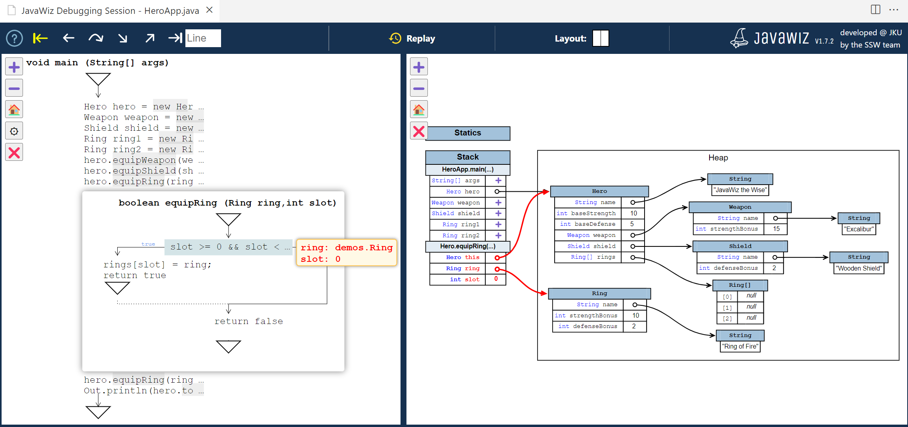
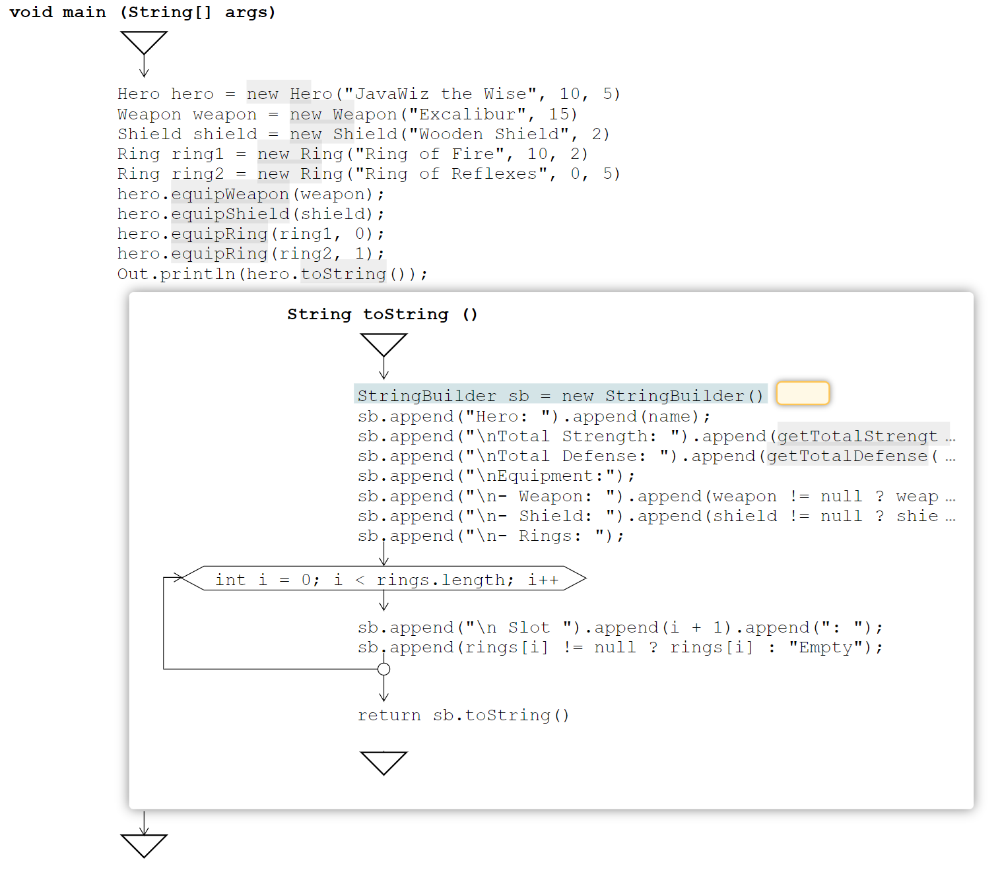
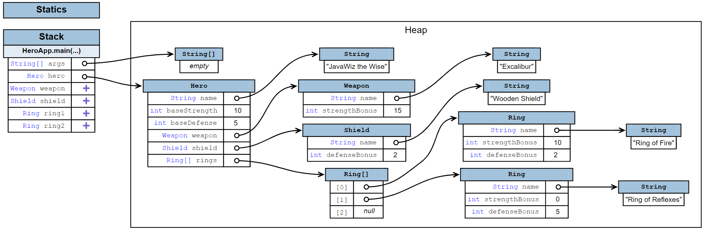
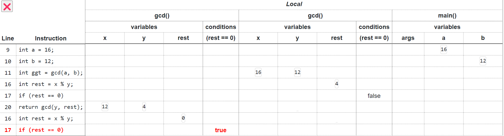
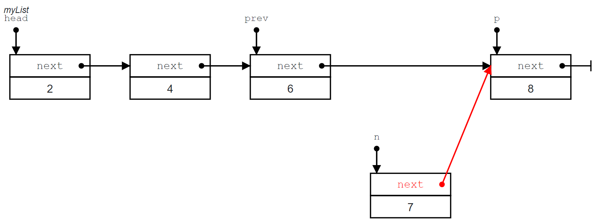
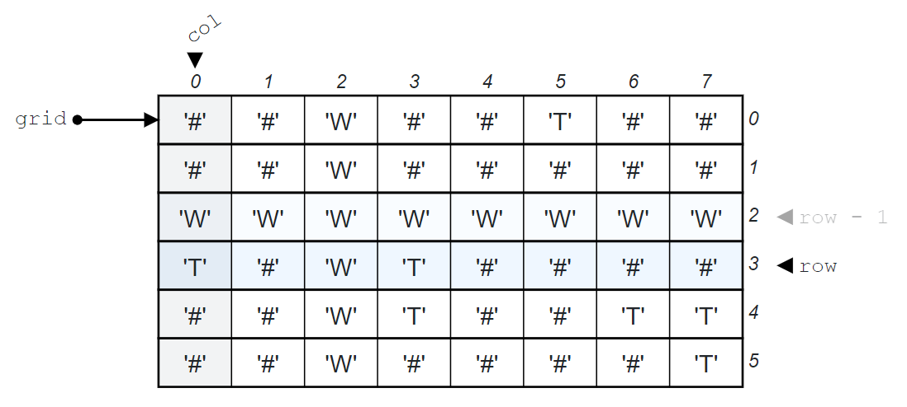
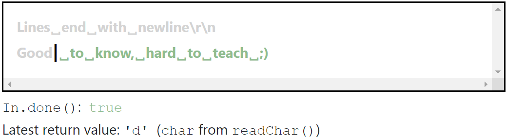
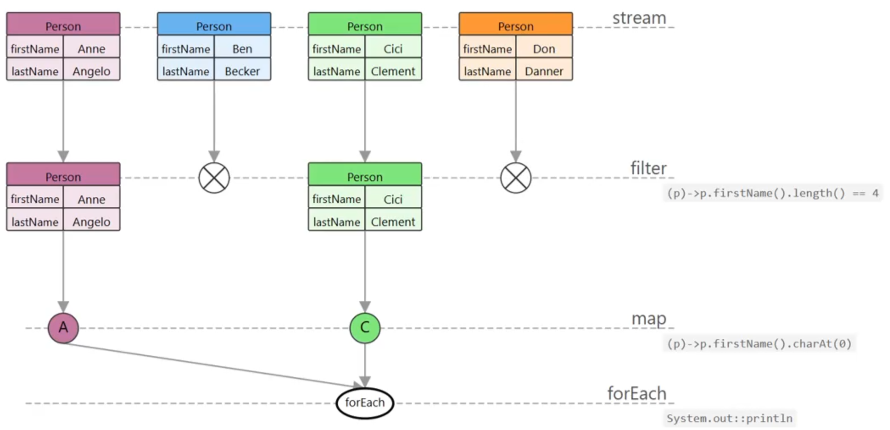

# 🧙 JavaWiz

### An educational visual / graphical debugger for Java

[](https://javawiz.net/)

[](https://marketplace.visualstudio.com/items?itemName=SSW-JKU.javawiz)
[](https://plugins.jetbrains.com/plugin/32457-javawiz)

[](https://github.com/SSW-JKU/javawiz/releases)
[](https://github.com/SSW-JKU/javawiz/releases/latest)

[](https://github.com/SSW-JKU/javawiz/actions/workflows/backend-tests.yml)
[](https://github.com/SSW-JKU/javawiz/actions/workflows/intellij-plugin-checks.yml)
[](https://github.com/SSW-JKU/javawiz/actions/workflows/frontend-checks.yml)
[](https://github.com/SSW-JKU/javawiz/actions/workflows/shared-checks.yml)
[](https://github.com/SSW-JKU/javawiz/actions/workflows/vsc-extension-checks.yml)

[](LICENSE.txt)

[🌐 Visit javawiz.net](https://javawiz.net/) · [📰 Read the news](https://javawiz.net/news.html) · [📋 View the changelog](https://javawiz.net/changelog.html)

JavaWiz helps programming beginners understand what their Java programs are doing. Step through code line by line and watch control flow, memory, variable histories, arrays, linked lists, binary trees, method calls, streams, input, and the complete execution history evolve in synchronized visualization panels.

Unlike a traditional debugger, JavaWiz records the execution trace. You can move backward and forward through a program without restarting it, making abstract runtime behavior concrete and easier to explain, explore, and revisit.

<p align="center">
  <a href="https://javawiz.net/">
    
  </a>
</p>

## ✨ Why JavaWiz?

- ⏪ **Time-travel debugging** — step backward, replay earlier states, and inspect an execution at your own pace.
- 🧭 **Visual control flow** — follow the currently executing statement in automatically generated flowcharts.
- 🧠 **Concrete memory models** — see stack frames, static variables, heap objects, references, and object relationships.
- 📊 **Tabular View** — track variable values and conditions from one statement to the next.
- 🧩 **Array visualization** — follow index expressions, assignments, and values moving between variables and array cells.
- 🔗 **Linked-list visualization** — see nodes, references, traversals, insertions, and deletions as they happen.
- 🌳 **Binary-tree visualization** — explore tree structure and watch traversal and update algorithms operate on it.
- 🌊 **Java Stream View** — trace execution order, transformations, intermediate results, and element lineage in dynamic marble diagrams.
- 🔁 **Sequence diagrams** — see how objects interact through method calls.
- ⌨️ **Input buffer visualization** — inspect consumed and remaining input when using JavaWiz's `In.java` class.
- 🔎 **Event History View** — browse calls and assignments across the complete trace, filter or search them, and jump directly to a matching execution state.
- 🎓 **Built for teaching and learning** — useful for individual exploration, exercises, and live classroom demonstrations.

## 🔍 Visualization Highlights

| Flowchart View | Memory View |
|:---:|:---:|
| [](https://javawiz.net/#features-section) | [](https://javawiz.net/#features-section) |
| Follow control flow, active statements, values, and method expansion. | Understand stack, statics, heap objects, and references. |

| Tabular View | List View and Tree View |
|:---:|:---:|
| [](https://javawiz.net/#features-section) | [](https://javawiz.net/#features-section) |
| Review execution history, variable changes, and conditions. | Watch traversal, insertion, deletion, and pointer changes. |

| Array View | Input View |
|:---:|:---:|
| [](https://javawiz.net/#features-section) | [](https://javawiz.net/#features-section) |
| See index expressions, assignments, and data movement. | See consumed input, remaining input, and operation results. |

| Stream View |
|:---:|
| [](https://javawiz.net/#features-section) |
| Follow execution order and element lineage through filtering, mapping, and terminal operations. |

## 🚀 Get JavaWiz

### Visual Studio Code

Install [JavaWiz from the Visual Studio Marketplace](https://marketplace.visualstudio.com/items?itemName=SSW-JKU.javawiz), open a Java file with a `main` method, and use **Debug with JavaWiz** above the `main` method or from the editor context menu. JavaWiz requires **Visual Studio Code 1.87.0 or newer**.

### IntelliJ IDEA

Install [JavaWiz from the JetBrains Marketplace](https://plugins.jetbrains.com/plugin/32457-javawiz): in IntelliJ IDEA, open **Settings → Plugins → Marketplace**, search for **JavaWiz**, and click **Install**. Then open a Java file with a `main` method and use **Debug *File* with JavaWiz** next to the `main` method or from the editor context menu. JavaWiz requires **IntelliJ IDEA 2026.2.1 or newer**.

To install without the Marketplace, download the plugin ZIP from [GitHub Releases](https://github.com/SSW-JKU/javawiz/releases) and choose **Settings → Plugins → ⚙ → Install Plugin from Disk**.

> JavaWiz currently requires **JDK 25 or newer**. In Visual Studio Code, JavaWiz uses the JDK from the setting `java.jdt.ls.java.home` if it is set, and otherwise `java` and `javac` from `PATH`.

## 📚 Research

JavaWiz was developed at the [Institute for System Software](https://ssw.jku.at/) at Johannes Kepler University Linz, Austria. Its design, extensions, and educational applications are described in:

> Markus Weninger, Simon Grünbacher, and Herbert Prähofer.<br>
> **JavaWiz: A Trace-Based Graphical Debugger for Software Development Education.**<br>
> 33rd IEEE/ACM International Conference on Program Comprehension (ICPC 2025).

[Read the paper](https://javawiz.net/paper/ICPC_25_Preprint.pdf)

> Melissa Sen and Markus Weninger.<br>
> **JavaWiz ThreadViz - A Visual Debugger for Multi-threaded Programs Based on the Espresso Java VM.**<br>
> 40th European Conference on Object-Oriented Programming (ECOOP 2026).

[Read the paper](https://javawiz.net/paper/ECOOP_26_Preprint.pdf)

> Markus Weninger.<br>
> **Towards Guided Omniscient Debugging in Education Using Pedagogical Execution Traces (PETs).**<br>
> Fourth Workshop on Future Debugging Techniques (DEBT 2026).

[Read the paper](https://javawiz.net/paper/DEBT_26_Preprint.pdf)

> Sebastian Stiegler and Markus Weninger.<br>
> **Dynamic Visualization of Java Stream Operations for Education Using Marble Diagrams.**<br>
> 14th IEEE Working Conference on Software Visualization (VISSOFT 2026).

[Read the paper](https://javawiz.net/paper/VISSOFT_26_Preprint.pdf)

## 🛠️ For Developers

JavaWiz is free and open source. Contributions, bug reports, and feature suggestions are welcome.

### Repository Structure

This project is a Gradle multi-project workspace consisting of five subprojects:

- **backend** — Kotlin/JVM WebSocket server that compiles and step-debugs Java programs using JDK internals
- **frontend** — Vue 3, TypeScript, and Vite visualization UI
- **shared** — TypeScript types shared between `frontend` and `vsc-extension`
- **vsc-extension** — TypeScript VS Code extension that orchestrates the backend and frontend
- **intellij-plugin** — Kotlin IntelliJ IDEA plugin that embeds the same backend and frontend in IDE tool windows

The frontend requires the backend to run to work properly.

### Building

Use the repository's Gradle wrapper from the project root:

```shell
# Build all projects
./gradlew clean build

# Build individual components
./gradlew :frontend:clean :frontend:build
./gradlew :backend:clean :backend:build
./gradlew :intellij-plugin:buildPlugin
```

On Windows, use `gradlew.bat` instead of `./gradlew`.

Build outputs:

- Frontend: `frontend/dist/index.html`
- Backend: `backend/build/libs/backend-<version>.jar`
- IntelliJ plugin: `intellij-plugin/build/distributions/JavaWiz-*.zip`

### Running Locally

#### Dev Environment

Perform the following two commands.

```shell
# Start the backend
./gradlew :backend:run
```

```shell
# Start the frontend development server
./gradlew :frontend:run
```

Then open the localhost URL printed by `:frontend:run`.

To run a second backend while another one already uses the default port 51234, start it on another port with `./gradlew :backend:run --args=51235` and open the frontend with `?backendPort=51235`, for example `http://localhost:5173/?backendPort=51235`.

These tasks are also available as IntelliJ run configurations when the repository is imported into IntelliJ IDEA.

#### Running the extension as IntelliJ plugin

Run the following command.

```shell
# Run the IntelliJ plugin in a sandboxed IDE
./gradlew :intellij-plugin:runIde
```

This automatically builds frontend and backend, packages them and runs the plugin in an IntelliJ session.

### Testing

```shell
# Run all checks
./gradlew check

# Run the backend suite on every configured JDK
./gradlew :backend:testAll

# Run the IntelliJ plugin tests
./gradlew :intellij-plugin:test

# Run the same tests against the newest stable IntelliJ IDEA
./gradlew :intellij-plugin:testLatestStableIde

# Check the plugin's structure and its compatibility with the oldest supported and the newest stable IntelliJ IDEA
./gradlew :intellij-plugin:verifyPluginStructure :intellij-plugin:verifyPlugin
```

The frontend, the shared code, and the VS Code extension are checked with npm. Run these commands from the repository root:

```shell
# Install the shared code's packages first; the frontend and the extension use them
cd shared && npm ci && cd ..

# Frontend: lint, type-check, build, and run all tests
cd frontend && npm ci && npm run lint && npm run build && npm test && cd ..

# Shared code: lint
cd shared && npm run lint && cd ..

# VS Code extension: lint, compile, and run its tests
cd vsc-extension && npm ci && npm run lint && npm test && cd ..
```

`./gradlew check` also runs the frontend lint and all frontend tests.

By default, Gradle prints only failed backend tests and suppresses test-process standard streams. Add `-PverboseTests` to a backend test command to print passed/skipped events and standard output/error, for example `./gradlew :backend:test -PverboseTests`.

Every part has its own GitHub Actions workflow. Each one runs on Windows and Linux for pushed commits, tags, pull requests, and published GitHub releases:

- **Backend:** all tests on every supported JDK.
- **Frontend:** lint, type check, production build, and all tests.
- **Shared code:** lint.
- **VS Code extension:** lint, compile, and tests.
- **IntelliJ plugin:** tests against the oldest supported and the newest stable IntelliJ IDEA. The plugin's structure and compatibility are checked on Linux only.

## Icons

Icons taken from [Flaticon](https://www.flaticon.com/) and others; for detailed attribution, [see the icon sources](https://github.com/SSW-JKU/javawiz/blob/main/frontend/src/assets/sources.txt).
